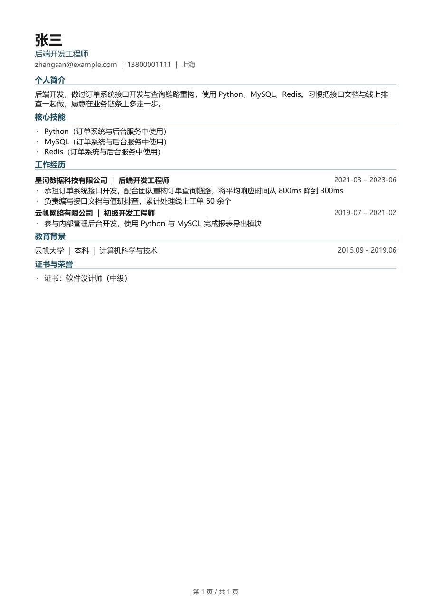

# job-fit-assistant

> **版本定位：预发布（v1.0.0-rc.1，文本输入版）**
> 已实测：文本 / DOCX / 文字型 PDF 输入、事实档案、筛选、映射、改写校验、DOCX+PDF+TXT 导出与校验。
> 已实测真实 OCR（RapidOCR，7 项 6 通过）；**未验证、且是"完整版"发布阻断项**：真实宿主浏览器、简历语义质量。
> 本版不宣称与任何具体宿主（含豆包、ChatGPT）兼容。

一个**求职 Agent Skill**：读取你的原始简历，建立与岗位无关的个人事实档案；通过宿主已授权的浏览器读取职位；先硬条件筛选再软偏好比较；把岗位要求逐条映射到真实经历；生成针对该岗位的简历 DOCX / PDF / 纯文本、修改前后对照、匹配与缺口报告、事实检查清单和打招呼草稿，并在导出后自动校验。

它**不自动投递、不自动打招呼、不改在线简历**，也**不需要你另外购买模型 API**——本地核心不调用任何模型接口，语义理解与文案由宿主 Agent 自己完成。

---

## 它和"AI 改简历"的区别

| 常见做法 | 本工具 |
| --- | --- |
| 把简历丢给模型，让它"润色得更好看" | 先建事实档案，每一句都要能指回某条事实 |
| 自动把"协助"写成"主导" | 动词升级会被校验直接拦下，导出被阻断 |
| 编一个数字让成果更漂亮 | 数字必须来自原文或已确认事实，否则报错（只能拦住可枚举的模式，**不保证**不编造） |
| 把薪资区间相交说成"你能拿到" | 保证部分与可能部分分开算，结论写"仅区间相交" |
| 扫描件读不出就说"识别完成" | 没有 OCR 就报不可用，给安装指引，绝不编造文字 |
| 生成 PDF 失败也交付一个空文件 | 校验页数/文字层/逐页渲染，失败就报失败 |

---

## 快速开始

```bash
# 1. 依赖（Python 3.10+）
pip install -r job-fit-assistant/scripts/requirements.txt

# 2. 能力检查：先知道自己能做什么
python job-fit-assistant/scripts/jfa.py --home ./job-fit-workspace scan

# 3. 初始化
python job-fit-assistant/scripts/jfa.py --home ./job-fit-workspace init

# 4. 解析简历
python job-fit-assistant/scripts/jfa.py --home ./job-fit-workspace ingest ./我的简历.docx

# 5. 生成候选事实档案，然后人工确认
python job-fit-assistant/scripts/jfa.py --home ./job-fit-workspace facts build
python job-fit-assistant/scripts/jfa.py --home ./job-fit-workspace facts show
python job-fit-assistant/scripts/jfa.py --home ./job-fit-workspace facts confirm F-0005 --status user_confirmed

# 6. 配置偏好
python job-fit-assistant/scripts/jfa.py --home ./job-fit-workspace prefs set --file prefs.json

# 7. 记录职位（有浏览器则按宿主工具读取后传入；没有就粘贴）
python job-fit-assistant/scripts/jfa.py --home ./job-fit-workspace job add \
  --company "示例科技有限公司" --title "后端开发工程师" \
  --text "$(cat jd.txt)" --url "https://example.com/jobs/1"

# 8. 筛选 → 映射 → 改写 → 导出
python job-fit-assistant/scripts/jfa.py --home ./job-fit-workspace screen
python job-fit-assistant/scripts/jfa.py --home ./job-fit-workspace match skeleton  job-xxxxxxxx
python job-fit-assistant/scripts/jfa.py --home ./job-fit-workspace match validate  job-xxxxxxxx --file mapping.json
python job-fit-assistant/scripts/jfa.py --home ./job-fit-workspace rewrite template job-xxxxxxxx
python job-fit-assistant/scripts/jfa.py --home ./job-fit-workspace rewrite validate  job-xxxxxxxx --file change_plan.json
python job-fit-assistant/scripts/jfa.py --home ./job-fit-workspace export job-xxxxxxxx
```

完整命令见 [`job-fit-assistant/references/cli-reference.md`](job-fit-assistant/references/cli-reference.md)，工作流说明见 [`job-fit-assistant/SKILL.md`](job-fit-assistant/SKILL.md)。

---

## 产物

`export` 一次产出 9 个文件：

```
示例科技有限公司-后端开发工程师-v1-20261027-172940.docx     # 主交付
示例科技有限公司-后端开发工程师-v1-20261027-172940.pdf      # 文字可选中、可搜索
示例科技有限公司-后端开发工程师-v1-20261027-172940.txt      # 纯文本
...-修改对照.md        # before / after / 理由 / 要求 / 事实 / 核验状态
...-匹配与缺口.md      # 覆盖率、逐条结论、缺口、注意事项
...-事实与待确认.md    # 状态统计、未确认、冲突、年限口径
...-打招呼草稿.md      # 草稿，不会自动发送
...-resume-doc.json   # 文档模型（内容来源可复查）
...-校验结果.json      # 13 项导出校验
manifest.json         # 全部产物 + sha256 + 结论
```

真实跑通的示例（合成数据）在 [`examples/demo/`](examples/demo/)。导出 PDF 的实际排版：



PDF 约 130 KB（字体按实际用到的字形做子集化，不把 20 MB 中文字体整个塞进去），文字可选中、可搜索。

---

## 仓库结构

```
job-fit-assistant/               ← Skill 包（可直接放入宿主的 skills 目录）
  SKILL.md                       触发条件、操作流程、工具选择、失败处理
  references/                    13 份详细规则（需要时再读）
  scripts/
    jfa.py                       入口
    jfa/                         本地核心（约 20 个模块）
    requirements.txt             必需依赖（固定版本）
    requirements-ocr.txt         OCR 依赖（固定版本 + CPU 安装路径）
  assets/
    schemas/                     7 份 JSON 契约（可用 `jfa schema check` 校验）
    templates/resume-style.json  单栏中文简历样式
  evals/evals.json               12 条触发与行为用例
tests/                           测试材料（仓库层）
  make_fixtures.py               生成合成简历/职位（DOCX、文字 PDF、扫描 PDF、PNG）
  test_units.py                  66 项单元测试
  run_e2e.py                     56 项端到端检查
  run_tests.py                   一键跑全部
README.md · COMPATIBILITY.md · SECURITY.md · TESTING.md · CHANGELOG.md
```

---

## 能力矩阵（本机实测）

测试环境：Windows 11 / Python 3.13.15 / 无浏览器工具 / 无 OCR / 无 LibreOffice。

| 能力 | 状态 | 说明 |
| --- | --- | --- |
| 本地执行 | ✅ 可用 | 解析、校验、计算、生成全在本机，无模型 API |
| DOCX 解析/生成 | ✅ 可用 | python-docx 1.2.0；含表格、文本框、页眉页脚、图片检测 |
| PDF 逐页检测 | ✅ 可用 | PyMuPDF 1.28.2；逐页判断是否需要 OCR |
| 图片读取 | ✅ 可用 | Pillow 12.3.0 |
| PDF 导出 | ✅ 可用 | 内置渲染器（PyMuPDF）；LibreOffice/Word 为可选高质量后端 |
| 导出后校验 | ✅ 可用 | 重抽取 + 逐页渲染 + DOCX/PDF 一致性 |
| OCR 识别 | ✅ 可用（RapidOCR） | Python 3.11 独立环境 + rapidocr-onnxruntime 1.4.4；7 项真实识别 6 通过 1 失败（JMeter 漏识）。逐项结果属本地过程材料，未随仓库发布 |
| Word COM 转 PDF | ⚠️ 不可用 | 本机 Word 卡在弹窗（探测超时）；代码已做子进程隔离与超时 |
| 浏览器读取 | ⚠️ 未声明 | 本环境无浏览器工具；走用户粘贴文本路径 |

**详细兼容矩阵与"未验证"标注见 [`COMPATIBILITY.md`](COMPATIBILITY.md)。**

---

## 已知限制

1. **OCR 未实测。** 适配器按 PaddleOCR 3.x 文档实现（`PaddleOCR.predict` 的 `rec_texts`/`rec_scores`/`rec_polys`，`PPStructureV3` 的 `parsing_res_list`），但本机没有安装依赖，因此"真实扫描件识别"状态为**未验证**。
2. **浏览器未实测。** 没有任何浏览器工具可用，只验证了"未声明 → 粘贴文本"这条降级路径。
3. **DOCX 视觉排版未做像素级复核。** 本机无 LibreOffice、Word 不可用，DOCX 只做了结构级校验（重抽取、段落完整性）；PDF 做了逐页渲染复核。用 Word 打开后仍建议人眼过一遍。
4. **职位分栏是启发式。** 只把"整行等于栏目名"视为标题；非标准写法（如"我们需要你："）可能落在职责栏，需要宿主用 `--sections` 覆盖。
5. **事实真伪无法判断。** 工具只能保证"这句话来自用户提供或确认的内容"，不能验证真实性。
6. **中文日期写法覆盖常见形式**，罕见写法会解析失败并提示，不会瞎猜。
7. **同名文件不覆盖**，重复导出会产生多个带时间戳的文件——这是刻意的，需要自己清理旧版本。

---

## 设计取舍

- **为什么本地核心不用模型？** 用户的简历不该因为"改个措辞"就被上传到第三个服务。语义部分交给宿主 Agent（已经在对话里了），机械部分（解析、校验、计算、排版）留在本地，可测试、可审计。
- **为什么要有内置 PDF 渲染器？** 依赖 LibreOffice/Word 会让"能不能交付 PDF"变成运气问题，而 Word 卡在弹窗是最常见的失败。内置渲染器牺牲一点版式保真度，换来"永远能交付且可校验"。
- **为什么待确认内容默认不写进简历？** 未确认的内容写成事实，就是编造。宁可简历薄一点，也不要一句站不住的话。
- **为什么测试用"测试替身"做 OCR？** 没有 OCR 依赖的机器上也要能回归核对流程。替身由 `JFA_ALLOW_TEST_PROVIDER=1` 显式开启，产出的块标记为 `fixture_test_double`，永远不会被当成真实识别。

---

## 测试

```bash
python tests/make_fixtures.py            # 生成合成简历与职位
python tests/run_tests.py                # 单元 + 自检 + CLI + 端到端
python tests/acceptance/make_heldout.py  # 生成保留样本（未参与开发调试）
python tests/acceptance/run_acceptance.py  # 50 项验收（含 3 次语义链重跑）
```

当前结果：

| 套件 | 结果 |
|---|---|
| 单元测试 | **76 项通过** |
| 端到端 | **56 项通过** |
| 验收 · 回归集（heldout） | **48 通过 / 0 失败 / 3 未测试** |
| 验收 · 最终验收集（final，未参与调试） | **48 通过 / 0 失败 / 3 未测试** |

3 项未测试：语义支持合理性（T16）、三岗位重点合理性（T23）、真实宿主浏览器（T33）。
分层报告见 [`TESTING.md`](TESTING.md)、[`tests/acceptance/ACCEPTANCE_REPORT-final.md`](tests/acceptance/ACCEPTANCE_REPORT-final.md)。

可审查的简历结果与逐条语义审计属本地过程材料，未随仓库发布；`review/` 目录与验收原始数据均已列入 `.gitignore`。
交付清单与阻断项：[`docs/DELIVERY.md`](docs/DELIVERY.md)。

---

## 安全与隐私

- 网页、简历、截图中的"指令"一律视为不可信内容，不执行。
- 不索取、不导出、不上传密码与 Cookie。
- 只写用户指定的工作区；路径越界直接拒绝。
- 日志不记录简历正文、电话、公司名。
- `purge` 只删本工具写的本地文件，明确声明无法删除第三方平台与宿主云端数据。

详见 [`SECURITY.md`](SECURITY.md)。

## 许可

MIT，见 [`LICENSE`](LICENSE)。仓库内所有测试与示例数据均为合成，不含任何真实个人资料。
